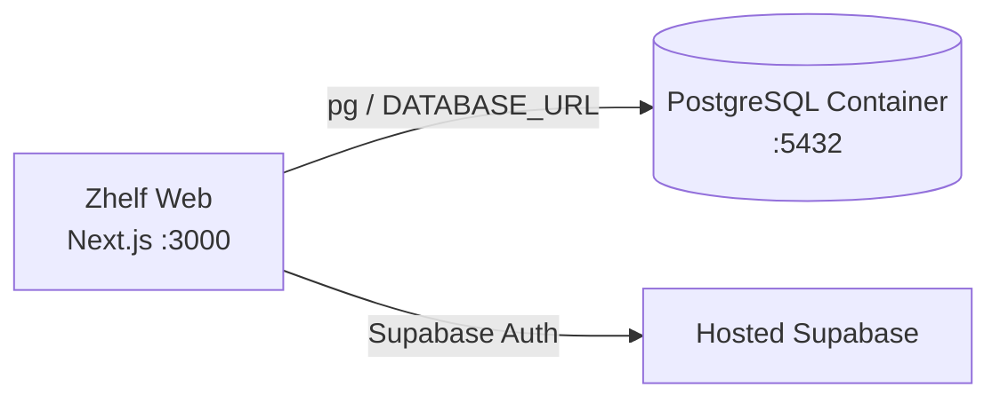

# Azure Debug Plan

> This plan is the source of truth for generating the
> VS Code debug setup in this workspace.
>
> **Status:** Implemented
> **Execution Mode:** Guided
> **Created:** 2026-10-12T14:13:51+01:00
> **Last Updated:** 2026-10-12T14:35:00+01:00
>
> <!-- Guided Mode (default) - hand-holds the user through review and approval before generating. -->

---

## Prerequisites

| Tool / Extension | Category          | Service(s) | Installed | Version                 |
| ---------------- | ----------------- | ---------- | --------- | ----------------------- |
| Node.js          | Runtime           | \*         | ❓        | —                       |
| npm              | Package manager   | \*         | ❓        | —                       |
| Docker           | Container runtime | zhelf-web  | ✅        | 29.8.2 (Docker Desktop) |
| Docker Compose   | Compose provider  | zhelf-web  | ✅        | v5.5.1                  |
| Chrome           | Browser           | zhelf-web  | ✅        | 154.0.8037.98           |

> ✅ **Confirmed:** Node.js is installed in the local VS Code environment, and Docker/Chrome are ready for local debugging. The debug config now defines the local Postgres connection and startup flow required by the Next.js app.

---

## Debug Configurations

| Generate | Debug Config Name | Service Label | Service Root | Project Type | Runtime | Version   | Azure Dependencies |
| -------- | ----------------- | ------------- | ------------ | ------------ | ------- | --------- | ------------------ |
| [x]      | Zhelf Web (debug) | Zhelf Web     | ./apps/web   | frontend-spa | node-ts | >=22.22.2 | PostgreSQL         |

ℹ️ Project Type Descriptions

| Project Type | Description                                                                    |
| ------------ | ------------------------------------------------------------------------------ |
| frontend-spa | Next.js web application with a local development server and browser debugging. |

> **Supabase note:** The app's Supabase client is currently configured for hosted Supabase. No local Supabase stack or Azure Storage SDK is detected. The local PostgreSQL emulator covers the app's direct `pg` database connection; Supabase Auth will remain hosted unless local Supabase is configured separately.

---

## Orchestrator

| Orchestrator   | Container Runtime | Compose Command  | Description                                                    |
| -------------- | ----------------- | ---------------- | -------------------------------------------------------------- |
| Docker Compose | Docker            | `docker compose` | Runs the local PostgreSQL emulator; Docker Desktop is running. |

---

## Emulators

| Dependent Service | Emulator             | Purpose                                                          |
| ----------------- | -------------------- | ---------------------------------------------------------------- |
| PostgreSQL        | PostgreSQL Container | Local database for the app's `pg` connection and SQL migrations. |

---

## Architecture Diagram

The Next.js service connects to a local PostgreSQL container for application data and to the currently configured hosted Supabase project for authentication.

---

## Migrations

When selected, the generation phase creates automated VS Code tasks that apply SQL migrations before debugging. The migration task must explicitly target the local PostgreSQL container; the existing `.env` files point to hosted Supabase and must not be used as the local migration target.

| Generate | Service   | Migration Tool                                    |
| -------- | --------- | ------------------------------------------------- |
| [x]      | Zhelf Web | Raw SQL (`scripts/apply-supabase-migrations.mjs`) |

---

## API Test Collections

| Generate | Service   | Description                                                                                                                                                                                                          |
| -------- | --------- | -------------------------------------------------------------------------------------------------------------------------------------------------------------------------------------------------------------------- |
| [x]      | Zhelf Web | 

HTTP Endpoints (7)
 GET /api/health GET /api/listings POST /api/listings GET /api/listings/:id GET /api/messages POST /api/messages GET /api/users/:id 
 |

---

## Convenience Scripts

| Generate | Script          | Registered In  | Description                                                                                  |
| -------- | --------------- | -------------- | -------------------------------------------------------------------------------------------- |
| [x]      | emulators:start | ./package.json | Start the local PostgreSQL container.                                                        |
| [x]      | emulators:stop  | ./package.json | Stop local emulator containers without deleting database data.                               |
| [x]      | emulators:clean | ./package.json | Stop containers and delete local emulator data; requires `npm run emulators:clean -- --yes`. |
| [x]      | db:migrate      | ./package.json | Apply pending SQL migrations to the local PostgreSQL database.                               |

---

## Debug Configuration Checklist

- [x] `docker-compose.yml` generated with the local PostgreSQL emulator and migration service.
- [x] `.vscode/launch.json` generated for the Zhelf Web Next.js app with the Chrome debug adapter.
- [x] `.vscode/tasks.json` generated with emulator startup, migration, and dev-server tasks.
- [x] `.vscode/settings.json` updated to hide local dependency noise.
- [x] Workspace-root `.env` populated with local PostgreSQL variables (`POSTGRES_USER`, `POSTGRES_PASSWORD`, `POSTGRES_DB`, `DATABASE_URL`).
- [x] API test collections generated under `api-test-collections/zhelf-web/` for the HTTP endpoints in scope.
- [x] Validation result: `docker compose config` rendered the local Postgres environment without blank variable warnings, and `docker compose up -d postgres` successfully started the PostgreSQL container.
- [x] Teardown result: local validation container was shut down before completion to leave the workspace clean.
